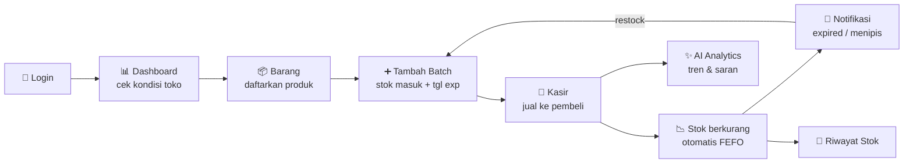
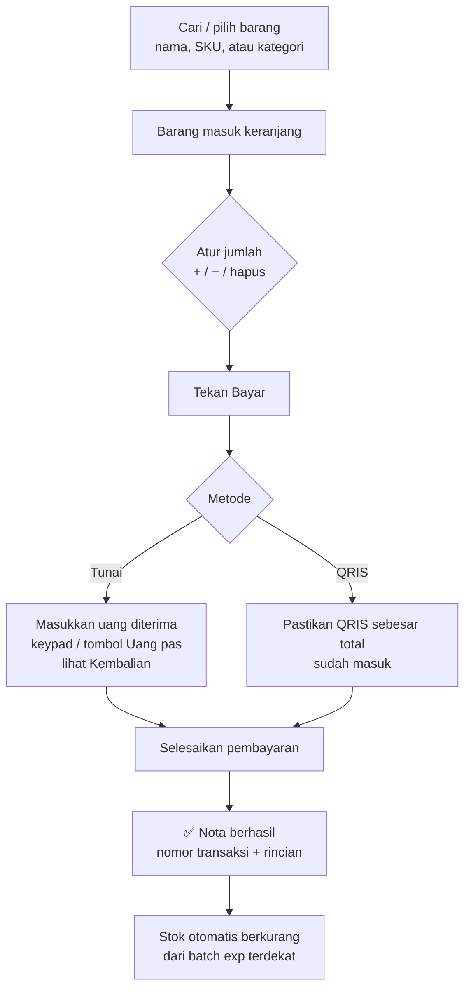

# Warung Sembako Ibu TR — Kasir & Inventaris

Aplikasi POS dan manajemen stok (FEFO) untuk satu pemilik toko.
Stack: Next.js 16 (App Router) · TypeScript · Tailwind CSS v4 · shadcn/ui (Base UI) · Supabase.

---

# 📖 Panduan Penggunaan

Bagian ini menjelaskan **cara memakai aplikasi dari awal sampai akhir**: dari login, memasukkan
barang, menjual di kasir, sampai memantau stok dan laporan. Bahasa dibuat sesederhana mungkin.
Kalau mau tahu teknisnya, lihat bagian [Untuk Developer](#-untuk-developer) di bawah.

## Gambaran besar

Aplikasi ini punya satu pengguna, yaitu **pemilik toko**. Alurnya kira-kira seperti siklus harian warung:



Singkatnya: **daftarkan barang → isi stoknya (batch) → jual di kasir → aplikasi otomatis
mengurangi stok, mengingatkan barang yang mau kedaluwarsa / menipis → kamu restock lagi.**

## Istilah penting (baca dulu ya)

| Istilah | Artinya | Contoh |
|---|---|---|
| **Barang / Produk** | Jenis barang yang dijual. Isinya nama, SKU, harga, satuan. | "Indomie Goreng", Rp3.500 / bungkus |
| **SKU** | Kode unik barang. Otomatis jadi huruf besar, tidak boleh kembar. | `INDOMIE-GRG` |
| **Batch** | Satu kali kiriman / belanja stok untuk satu barang, lengkap dengan jumlah dan tanggal kedaluwarsanya. Satu barang bisa punya banyak batch. | Batch `B-0611`: 40 bungkus, exp 20-03-2027 |
| **FEFO** | *First Expired, First Out* — yang kedaluwarsanya **paling dekat dijual duluan**. Aplikasi melakukannya otomatis. | Batch exp Maret terjual sebelum batch exp Juni |
| **Stok tersedia** | Stok yang **boleh dijual**: batch aktif, masih ada sisa, dan belum lewat tanggal exp. | |
| **Stok fisik** | Semua sisa barang di rak, termasuk yang sudah expired. | |
| **Stok minimum** | Batas bawah. Kalau stok tersedia ≤ angka ini, barang dianggap **menipis**. | Minimum 10 → sisa 8 = menipis |
| **Hampir kedaluwarsa** | Tanggal exp tinggal **≤ 30 hari** lagi. | |
| **Kedaluwarsa (expired)** | Tanggal exp **sudah lewat**. Barang kedaluwarsa *hari ini* masih boleh dijual; mulai besok tidak. | |

> 🕖 Semua "hari ini" mengikuti **jam WIB (Asia/Jakarta)**, bukan jam server.

## Menu di sidebar

| Menu | Kegunaan |
|---|---|
| **Dashboard** | Ringkasan penjualan hari ini dan kondisi stok yang perlu diperhatikan. |
| **Barang** | Daftar semua produk, tambah/ubah barang, tambah batch, keluarkan stok. |
| **Stok** | Riwayat semua keluar-masuk stok (masuk, terjual, expired, rusak, koreksi). |
| **Catat Offline** | Mencatat penjualan yang terjadi tanpa lewat kasir (lupa dicatat). |
| **Notifikasi** | Daftar peringatan: expired, hampir expired, stok menipis. |
| **AI Analytics** | Analisis tren penjualan, performa produk, dan rekomendasi dari AI. |
| **Buka Kasir** (tombol besar di bawah) | Masuk ke mode kasir untuk melayani pembeli. |

---

## Langkah 1 — Masuk (Login)

1. Buka aplikasi. Kalau belum login, kamu otomatis diarahkan ke halaman **Masuk**.
2. Isi **email** dan **password** akun pemilik, lalu tekan **Masuk ke akun toko**.
3. Setelah berhasil, kamu langsung dibawa ke **Dashboard**.

> Tidak ada tombol daftar. Akun pemilik dibuat sekali lewat Supabase (lihat bagian developer).
> Untuk keluar, klik nama/email di pojok kanan atas → **Keluar**.

## Langkah 2 — Kenali Dashboard

Dashboard adalah "layar pagi" untuk melihat kondisi toko sekilas:

- **Ringkasan hari ini** — total penjualan, jumlah transaksi, unit terjual, dan rata-rata per nota.
- **Metode pembayaran** — perbandingan Tunai vs QRIS.
- **Transaksi terakhir** — daftar nota terbaru.
- **Chip peringatan** — misalnya "3 barang expired", "5 hampir kedaluwarsa", "2 stok menipis".
- **Tab perhatian** — *Expired / Hampir expired / Menipis*, berisi daftar barang yang perlu ditindak.

Kalau dashboard masih kosong, artinya belum ada barang. Lanjut ke Langkah 3.

## Langkah 3 — Daftarkan Barang

Menu **Barang** → tombol **Tambah Barang** → isi form → **Simpan Barang**. Isi form:

| Kolom | Keterangan |
|---|---|
| Nama barang | Wajib. |
| SKU | Wajib, unik, otomatis huruf besar. |
| Kategori | Wajib. Kategori menentukan apakah barang **wajib punya tanggal kedaluwarsa** dan berapa hari exp default-nya. |
| Satuan | Wajib. Contoh: pcs, bungkus, kg. |
| Stok minimum | Batas untuk peringatan "stok menipis". |
| Harga beli & harga jual | Dalam Rupiah. Harga jual inilah yang dipakai kasir. |
| URL gambar | Opsional, untuk foto di kasir. |

Setelah disimpan, barang muncul di daftar **tetapi stoknya masih 0**, jadi belum bisa dijual.
Stok baru ada setelah kamu menambahkan **batch**.

**Mengubah / menonaktifkan barang:** buka detail barang (klik barangnya) → **Edit** atau
**Nonaktifkan**. Barang tidak pernah dihapus permanen; barang nonaktif hanya disembunyikan dari kasir
dan bisa **diaktifkan kembali** kapan saja (riwayat transaksinya tetap aman).

## Langkah 4 — Masukkan Stok (Tambah Batch)

Setiap kali ada barang datang (belanja ke agen/grosir), catat sebagai **batch baru**:

1. Buka **Barang** → klik barangnya → **Tambah Batch Stok**.
2. Isi:
   - **Nomor batch** — bebas tetapi unik per barang (mis. tanggal belanja `B-0611`).
   - **Jumlah** — berapa unit yang datang.
   - **Tanggal masuk** — default hari ini.
   - **Tanggal kedaluwarsa** — terisi **otomatis** dari kategori (bisa diganti sesuai yang tertera
     di kemasan; ada tombol untuk mengembalikan ke tanggal otomatis).
     Untuk kategori yang punya masa exp, kolom ini **wajib**.
   - **Harga beli per unit**.
3. Tekan **Simpan Batch**. Stok tersedia barang langsung bertambah, dan riwayat **"Masuk"** tercatat di menu Stok.

```
Barang: Indomie Goreng (minimum 10)
 ├─ Batch B-0601 : sisa 12  exp 2026-12-01   ← dijual duluan (FEFO)
 ├─ Batch B-0611 : sisa 40  exp 2027-03-20
 └─ Stok tersedia = 52 → status "Stok aman"
```

Di halaman detail barang, setiap batch diberi label:
**Aman** · **Segera Expired** (≤ 30 hari) · **Expired** · **Habis**.

## Langkah 5 — Jualan di Kasir 🛒

Tekan **Buka Kasir** di sidebar. Layar berubah ke **mode kasir** (fokus penuh, sidebar dikunci).



**Detailnya:**

1. **Pilih barang** — ketik nama atau SKU di kolom pencarian, atau saring per kategori, lalu klik
   kartunya. Hanya barang aktif yang punya stok tersedia yang bisa dijual.
2. **Atur keranjang** — ubah jumlah dengan tombol + / −, hapus satu barang, atau kosongkan pesanan.
   Jumlah tidak bisa melebihi stok tersedia.
3. **Tekan Bayar**, pilih metode:
   - **Tunai** — ketik uang yang diterima (atau tekan **Uang pas**). Aplikasi menampilkan
     **Kembalian**, atau **Kurang** jika uangnya belum cukup.
   - **QRIS** — pastikan dana sebesar total sudah masuk, lalu tekan **Selesaikan pembayaran**.
4. Muncul **nota sukses** berisi nomor transaksi, rincian barang, total, bayar, dan kembalian.

**Yang terjadi otomatis di belakang layar** (semuanya sekaligus, tidak bisa setengah jadi):
transaksi dicatat → stok dikurangi dari batch dengan **exp paling dekat (FEFO)** → riwayat
"Penjualan" ditulis di menu Stok.

**Pengaman di kasir:**

| Situasi | Yang dilakukan aplikasi |
|---|---|
| Stok habis karena berubah saat kamu melayani | Muncul pesan "stok tidak cukup", katalog diperbarui. Sesuaikan jumlah lalu bayar lagi. |
| Harga barang berubah | Muncul total terbaru; periksa keranjang lalu bayar lagi. |
| Internet putus saat menekan Bayar | Status "belum pasti". **Tekan Bayar lagi saja** — transaksi dijamin **tidak tercatat dua kali**. |
| Mau pindah menu / logout saat keranjang berisi | Muncul konfirmasi dulu. Saat pembayaran sedang diproses atau statusnya belum pasti, kamu **tidak bisa keluar** dari kasir agar transaksi tidak hilang. |
| Menutup / refresh tab saat ada isi keranjang | Browser menampilkan peringatan. |

## Langkah 6 — Catat Penjualan Offline

Kadang ada pembeli dilayani tanpa membuka kasir (misal waktu ramai). Catat belakangan lewat
menu **Catat Offline**:

1. Ketik nama barang di kolom pencarian → pilih. Pilih lagi barang yang sama untuk menambah jumlahnya.
2. Atur jumlah per barang.
3. Pilih metode: **Tunai** atau **QRIS** (uang dianggap pas, tanpa kembalian).
4. Tekan **Simpan penjualan**. Penjualan dicatat **persis seperti transaksi kasir** (harga dari database,
   stok dikurangi FEFO, muncul di dashboard).

## Langkah 7 — Keluarkan Stok yang Tidak Terjual

Barang yang **expired, rusak, atau hilang** harus dikeluarkan supaya angka stok sesuai rak.
Buka **Barang** → detail barang → **Keluarkan stok**, lalu pilih alasan:

| Alasan | Kapan dipakai | Cara kerja |
|---|---|---|
| **Kedaluwarsa** | Lewat tanggal exp | Mengeluarkan **semua** sisa batch yang sudah expired sekaligus. |
| **Rusak** | Sobek, pecah, basi | Kamu isi jumlahnya; diambil dari batch layak jual secara FEFO. |
| **Koreksi** | Hilang atau salah hitung | Sama seperti Rusak. |

Tambahkan **catatan** (opsional, maks. 200 karakter) — misalnya "Kemasan sobek kena tikus".
Semua pengeluaran tercatat di menu **Stok**.

## Langkah 8 — Pantau Notifikasi 🔔

Aplikasi **memeriksa stok secara otomatis**: saat aplikasi dibuka, setiap 5 menit selama tab
terbuka, dan setiap kali kamu kembali ke tab ini. Jika ada temuan baru, muncul pop-up kecil
(toast) dan angka di ikon lonceng bertambah.

Tiga jenis peringatan:

- 🚫 **Kedaluwarsa** — batch sudah lewat exp (otomatis tidak dihitung sebagai stok tersedia).
- ⏰ **Hampir kedaluwarsa** — exp ≤ 30 hari lagi. Saatnya dijual lebih cepat / diberi promo.
- 📉 **Stok menipis** — stok tersedia ≤ stok minimum. Saatnya belanja lagi.

Di menu **Notifikasi** kamu bisa menyaring per jenis dan menandai **sudah dibaca** (satu per satu
atau semua). Urutannya dibuat **berdasarkan yang paling mendesak**:

```
1. Sudah expired
2. Exp 0–3 hari lagi
3. Exp 4–7 hari lagi
4. Stok menipis & sudah habis (0)
5. Exp 8–30 hari lagi
6. Stok menipis tapi masih ada
7. Sudah teratasi (batch habis / sudah direstock / barang dinonaktifkan)
```

> 📲 **Telegram (opsional):** jika `TELEGRAM_BOT_TOKEN` dan `TELEGRAM_CHAT_ID` diisi di `.env.local`,
> peringatan baru yang belum dibaca juga dikirim ke Telegram pemilik dalam satu pesan ringkas.

**Cara menindaklanjuti:**

| Notifikasi | Tindakan |
|---|---|
| Kedaluwarsa | **Keluarkan stok** dengan alasan *Kedaluwarsa* (Langkah 7). |
| Hampir kedaluwarsa | Taruh di depan rak / beri diskon. Kasir otomatis menjual batch ini duluan. |
| Stok menipis | Belanja lalu **Tambah Batch Stok** baru (Langkah 4). |

## Langkah 9 — Lihat Riwayat Stok

Menu **Stok** berisi buku besar semua pergerakan barang:

- **Ringkasan** di atas, lalu **tabel riwayat** di bawahnya (25 baris per halaman).
- **Filter**: per barang, per jenis (*Masuk / Penjualan / Kedaluwarsa / Rusak / Koreksi*), dan
  rentang tanggal (*30 hari terakhir* default, *7 hari terakhir*, *Bulan ini*, atau atur sendiri,
  maks. 1 tahun).
- Angka **positif** = stok masuk, **negatif** = stok keluar.

Berguna untuk menjawab pertanyaan seperti *"Kemarin Indomie keluar berapa?"* atau
*"Bulan ini berapa banyak barang yang terbuang karena expired?"*

## Langkah 10 — AI Analytics ✨

Menu **AI Analytics** membantu membaca data penjualan:

1. Pilih periode: **7 / 30 / 90 hari**.
2. Lihat **tren penjualan** dan **performa produk** (laris vs. kurang laku).
3. Minta **laporan & rekomendasi AI** (mis. barang yang perlu direstock).
4. **Tanya AI** lewat chat, misalnya *"Barang apa yang paling laku minggu ini?"*

> Fitur ini butuh `GEMINI_API_KEY` di `.env.local`. Label "Segera" di menu menandakan fitur ini
> masih dalam pengembangan, jadi hasilnya sebaiknya dipakai sebagai bahan pertimbangan saja.

---

## Rutinitas harian yang disarankan

| Waktu | Kegiatan |
|---|---|
| **Buka toko** | Login → cek **Dashboard** & **Notifikasi**. Keluarkan barang expired, pindahkan yang hampir expired ke depan. |
| **Saat ada kiriman** | **Barang** → **Tambah Batch Stok** untuk setiap barang yang datang. |
| **Melayani pembeli** | **Buka Kasir** → pilih barang → **Bayar**. |
| **Lupa catat** | **Catat Offline**. |
| **Ada barang rusak/hilang** | **Keluarkan stok** dengan alasan *Rusak* / *Koreksi*. |
| **Tutup toko** | Cek **Dashboard** untuk omzet hari ini. Sesekali lihat **Stok** & **AI Analytics** untuk evaluasi. |

## Pertanyaan yang sering muncul (FAQ)

**Barang sudah saya tambahkan, kok tidak muncul di kasir?**
Barang baru stoknya 0. Tambahkan **batch** dulu. Pastikan juga barangnya **aktif** dan batch-nya
belum kedaluwarsa.

**Stok di rak ada, tapi aplikasi bilang habis?**
Kemungkinan sisa stok itu sudah **expired**, jadi tidak dihitung sebagai stok tersedia. Cek detail
barang; batch berlabel *Expired* perlu dikeluarkan.

**Bisa hapus barang?**
Tidak bisa dihapus permanen supaya riwayat transaksi tetap utuh. Gunakan **Nonaktifkan**.

**Internet putus waktu bayar, transaksinya tercatat atau tidak?**
Tekan **Bayar** lagi. Aplikasi memakai kode transaksi yang sama, jadi kalau ternyata sudah tercatat,
yang muncul adalah nota yang sama, bukan transaksi kedua.

**Kenapa ada pembayaran "Debit / EDC" di dashboard?**
Itu dari transaksi lama. Kasir sekarang hanya menerima **Tunai** dan **QRIS**.

---

# 🛠 Untuk Developer

## Menjalankan

```bash
cp .env.example .env.local   # isi URL & publishable key Supabase
npm install
npm run dev                  # http://localhost:3000
```

### Akun pemilik

Tidak ada halaman registrasi. Buat satu akun di **Supabase Dashboard → Authentication → Users → Add user**
(email + password), lalu disarankan menonaktifkan **Allow new users to sign up**.

### Tipe database

`types/database.ts` ditulis dari dump katalog skema yang sebenarnya (format `supabase gen types`).
`types/domain.ts` menurunkan tipe domain dari sana. Jika skema berubah, perbarui keduanya.

### Tanggal bisnis

Database berjalan di UTC; tanggal bisnis toko adalah **Asia/Jakarta (WIB)**. Aplikasi tidak memakai
`CURRENT_DATE` database (termasuk `get_product_available_stock()` dan `refresh_expired_batches()`);
"hari ini" selalu dari `getStoreToday()` dan dikirim eksplisit ke query.

## Struktur

```
app/
  login/                 halaman masuk (publik)
  (app)/                 semua halaman terproteksi + layout shell
    dashboard/ kasir/ barang/ stok/ notifikasi/ ai-analytics/
components/
  ui/                    primitif shadcn/ui
  shared/                komponen desain bersama (StatusBadge, EmptyState, StatCard, …)
  layout/                sidebar, header, menu notifikasi & pemilik
features/
  auth/                  server actions login/logout, query sesi
  inventory/             aturan bisnis (FEFO, kedaluwarsa, stok menipis) + badge
  dashboard/ pos/ notifications/   data layer + komponen per modul
  analytics/             kontrak modul AI (belum diimplementasikan)
lib/
  supabase/              client browser, server, dan proxy (refresh sesi)
  format.ts status.ts constants.ts
types/                   tipe domain
proxy.ts                 proteksi rute (Next.js 16: pengganti middleware)
```

## Konvensi data

Semua halaman membaca data asli Supabase dengan sesi owner (RLS berlaku). Fungsi query
mengembalikan `QueryResult<T>` = `{ data, error }`; halaman menampilkan `ErrorState` bila gagal.
Tidak ada data contoh di aplikasi.

## Aturan bisnis (features/inventory/lib/business-rules.ts)

- **FEFO**: batch dengan tanggal kedaluwarsa paling awal dijual lebih dulu.
- **Stok tersedia**: batch `ACTIVE`, `remaining_quantity > 0`, dan `expiry_date` kosong atau `>= hari ini WIB`.
- **Kedaluwarsa**: `expiry_date < hari ini WIB` → tidak boleh dijual. Kedaluwarsa hari ini masih boleh dijual.
- **Sinkronisasi expired**: saat aplikasi dibuka, batch expired diubah ke `EXPIRED` dan dibuatkan satu
  notifikasi per batch (dijamin oleh constraint `UNIQUE (batch_id, type)`).
- **Hampir kedaluwarsa**: kedaluwarsa dalam ≤ 30 hari.
- **Stok menipis**: stok tersedia ≤ `minimum_stock`. **Habis**: stok tersedia = 0.
