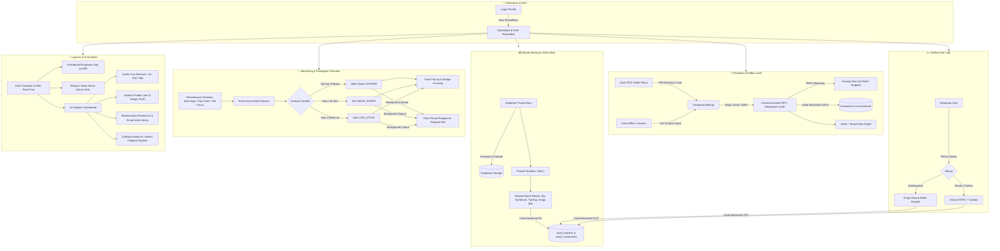

# Warung Sembako Ibu TR — Kasir & Inventaris Pintar

Aplikasi Point of Sale (POS) modern, manajemen inventaris berbasis **FEFO (*First Expired, First Out*)**, asisten bisnis bertenaga **Google Gemini AI**, dan sistem monitoring terintegrasi **Telegram Bot** yang dirancang khusus untuk pemilik toko sembako.

**Teknologi Utama:** Next.js 16 (App Router) · React 19 · TypeScript · Tailwind CSS v4 · Base UI / shadcn/ui · Supabase (PostgreSQL & Storage) · Google Generative AI (Gemini Flash) · Recharts.

---

## 📑 Daftar Isi

- [Ringkasan & Peta Alur Sistem Web](#-ringkasan--peta-alur-sistem-web)
- [10 Alur Utama Web](#-10-alur-utama-web-disimpulkan)
  - [1. Alur Autentikasi & Keamanan Sesi](#1-alur-autentikasi--keamanan-sesi)
  - [2. Alur Master Barang & Foto Produk](#2-alur-master-barang--foto-produk)
  - [3. Alur Inflow Stok (Tambah Batch & FEFO Rules)](#3-alur-inflow-stok-tambah-batch--fefo-rules)
  - [4. Alur Transaksi Kasir POS (Focus Mode & Atomik FEFO)](#4-alur-transaksi-kasir-pos-focus-mode--atomik-fefo)
  - [5. Alur Penjualan Cepat (Catat Offline)](#5-alur-penjualan-cepat-catat-offline)
  - [6. Alur Outflow Non-Jual (Keluarkan Stok / Penyesuaian)](#6-alur-outflow-non-jual-keluarkan-stok--penyesuaian)
  - [7. Alur Monitoring Otomatis & Notifikasi Multi-Channel](#7-alur-monitoring-otomatis--notifikasi-multi-channel)
  - [8. Alur Audit Trail & Buku Besar Riwayat Stok](#8-alur-audit-trail--buku-besar-riwayat-stok)
  - [9. Alur AI Analytics & Chatbot Bisnis](#9-alur-ai-analytics--chatbot-bisnis)
  - [10. Alur Siklus Operasional Harian Warung](#10-alur-siklus-operasional-harian-warung)
- [Struktur Menu & Antarmuka](#-struktur-menu--antarmuka)
- [Aturan Bisnis Inti (Core Business Rules)](#-aturan-bisnis-inti-core-business-rules)
- [Panduan Developer & Instalasi](#-panduan-developer--instalasi)
  - [Prasyarat & Konfigurasi .env.local](#prasyarat--konfigurasi-envlocal)
  - [Persiapan Supabase (Database & Storage)](#persiapan-supabase-database--storage)
  - [Persiapan Google Gemini API](#persiapan-google-gemini-api)
  - [Persiapan Bot Telegram (Opsional)](#persiapan-bot-telegram-opsional)
  - [Struktur Kode & Arsitektur](#struktur-kode--arsitektur)
- [Pertanyaan yang Sering Muncul (FAQ)](#-pertanyaan-yang-sering-muncul-faq)

---

# 🗺 Ringkasan & Peta Alur Sistem Web

Sistem Warung Sembako Ibu TR menghubungkan setiap aktivitas warung (pembelian stok, display rak, penjualan di kasir, pengecekan tanggal kedaluwarsa, hingga analisa data omzet) ke dalam satu ekosistem terpadu.



---

# 🔄 10 Alur Utama Web (Disimpulkan)

### 1. Alur Autentikasi & Keamanan Sesi
- **Pintu Masuk Tunggal**: Aplikasi dirancang untuk satu akun pemilik toko. Tidak ada registrasi publik.
- **Proteksi Rute (`proxy.ts`)**: Pengganti middleware modern pada Next.js 16. Setiap permintaan ke rute `/(app)/*` dicek secara optimistik melalui cookie sesi Supabase. Jika tidak ada sesi, pengguna langsung dialihkan ke `/login`.
- **Verifikasi Server (`AuthenticatedShell`)**: Memvalidasi ulang keaslian sesi langsung ke Supabase Auth pada level server component.
- **Isolasi Data (RLS)**: Row Level Security aktif di seluruh tabel database PostgreSQL, menjamin hanya pemilik terotentikasi yang dapat membaca dan memodifikasi data.

### 2. Alur Master Barang & Foto Produk
- **Pendaftaran Master Data (`/barang`)**: Pemilik mendaftarkan barang dengan nama, SKU unik (otomatis dikonversi ke huruf besar), kategori, satuan (pcs, bungkus, botol, kg, dll), batas stok minimum, harga beli referensi, dan harga jual.
- **Upload Foto Produk Cerdas (`ProductPhotoField`)**:
  - Pemilik bisa memotret langsung dengan **Kamera HP**, memilih file dari **Galeri**, atau menempel **URL Gambar**.
  - Foto yang dipilih dari kamera/galeri **langsung dikompresi di browser** menggunakan Canvas API (`shrinkImage` maks sisi 800px, JPEG quality 82%) hingga berukuran ringan (±100 KB).
  - Foto otomatis diunggah ke Supabase Storage bucket `product-images`, menghasilkan link publik permanen yang cepat dimuat.
- **Prinsip Stok Nol**: Barang yang baru dibuat otomatis memiliki stok tersedia = 0 dan belum bisa dijual di kasir sebelum batch stoknya ditambahkan.
- **Soft Delete**: Barang tidak pernah dihapus permanen dari database demi menjaga integritas transaksi lama. Barang cukup dinonaktifkan (`is_active = false`), sehingga disembunyikan dari katalog kasir dan bisa diaktifkan kembali kapan saja.

### 3. Alur Inflow Stok (Tambah Batch & FEFO Rules)
- **Konsep Batch**: Setiap pengiriman atau belanjaan kulakan dicatat sebagai satu batch tersendiri pada detail barang (`/barang/[id]`).
- **Data Batch**: Nomor batch (misal `B-0611`), jumlah unit masuk, tanggal masuk (default hari ini WIB), tanggal kedaluwarsa, dan harga beli riil batch tersebut.
- **Kalkulasi Kedaluwarsa Otomatis**: Kategori barang menentukan apakah tanggal exp wajib diisi dan menyediakan default hari exp (misal: Roti 7 hari, Minuman 180 hari). Pemilik dapat menyesuaikan tanggal sesuai kemasan fisik.
- **Pencatatan Otomatis**: Sistem langsung memperbarui stok tersedia dan mencatat entri mutasi masuk bertipe `IN` di tabel riwayat pergerakan stok.

### 4. Alur Transaksi Kasir POS (Focus Mode & Atomik FEFO)
- **POS Focus Mode (`/kasir`)**: Antarmuka kasir dirancang tanpa gangguan—sidebar dan header aplikasi dikunci agar kasir fokus melayani pembeli.
- **Navigasi Terlindungi (`PosNavigationGuardProvider`)**: Mencegah kasir keluar dari layar, me-refresh, atau menutup tab secara tidak sengaja ketika keranjang masih terisi atau ketika pembayaran sedang diproses.
- **Pencarian & Keranjang**: Pencarian instan berdasarkan nama barang atau SKU, filter per kategori, dan penyesuaian kuantitas secara responsif. Barang tanpa stok layak jual otomatis terkunci.
- **Pembayaran**:
  - **Tunai**: Dilengkapi keypad cepat, tombol uang pas, dan kalkulator kembalian otomatis.
  - **QRIS**: Verifikasi nominal yang harus dibayar pembeli.
- **Idempotensi Transaksi**: Klien membuat `transactionId` (UUID) sebelum memanggil server. Jika koneksi internet terputus di tengah proses pembayaran dan tombol ditekan lagi, sistem mengembalikan nota yang sama tanpa menduplikasi pemotongan stok atau nomor nota.
- **Checkout Atomik (RPC PostgreSQL `checkout_transaction`)**:
  - Mengecek validitas harga dan kecukupan stok secara bersamaan.
  - Memotong sisa kuantitas batch dengan urutan **FEFO (*First Expired, First Out*)**—batch yang paling cepat kedaluwarsa dialokasikan terlebih dahulu.
  - Jika satu batch tidak cukup, alokasi berlanjut ke batch berikutnya secara berantai.
  - Menulis transaksi, rincian barang, alokasi batch, dan riwayat mutasi stok `SALE` dalam satu transaksi database (ACID).
- **Nota Digital**: Menampilkan ringkasan nomor nota transaksi, rincian produk, total bayar, dan kembalian.

### 5. Alur Penjualan Cepat (Catat Offline)
- **Fungsi Susulan (`/catat-offline`)**: Disediakan saat warung sangat ramai dan kasir melayani pembeli secara manual di meja tanpa sempat membuka layar kasir utama.
- **Pencatatan Cepat**: Memilih beberapa barang lewat input combo pencarian, mengatur jumlah, memilih metode pembayaran (Tunai/QRIS), dan menyimpan.
- **Integritas Sama Persis**: Menggunakan jalur server action dan RPC `checkout_transaction` yang sama dengan kasir utama (alokasi FEFO otomatis, harga dari master data, uang pas, dan idempoten).

### 6. Alur Outflow Non-Jual (Keluarkan Stok / Penyesuaian)
- **Penyesuaian Fisik di Rak**: Barang yang rusak, bocor, hilang, atau melewati tanggal kedaluwarsa dikeluarkan melalui dialog **Keluarkan Stok** di detail barang:
  - **Kedaluwarsa (`EXPIRED`)**: Mengeluarkan seluruh sisa stok dari semua batch yang sudah melewati masa exp secara serentak.
  - **Rusak (`DAMAGE`)**: Mengurangi kuantitas tertentu dari batch yang layak jual menggunakan urutan FEFO, disertai catatan alasan kerusakan.
  - **Koreksi Stok (`ADJUSTMENT_OUT`)**: Untuk selisih hitung fisik atau barang hilang.
- **Audit Mutasi**: Seluruh pengeluaran stok tercatat dengan kuantitas negatif di buku besar riwayat stok.

### 7. Alur Monitoring Otomatis & Notifikasi Multi-Channel
- **Pemicu Otomatis (`InventoryNotificationSync`)**:
  - Berjalan otomatis di latar belakang saat aplikasi pertama kali dibuka.
  - Berulang secara periodik setiap 5 menit selama tab browser aktif.
  - Berjalan instan saat pemilik berpindah kembali ke tab aplikasi (`visibilitychange` & `focus`).
- **3 Tingkat Peringatan**:
  1. 🚫 **Kedaluwarsa (`EXPIRED`)**: Batch yang `expiry_date < hari ini WIB` langsung diubah statusnya menjadi `EXPIRED`, dinonaktifkan dari stok kasir, dan dibuatkan notifikasi.
  2. ⏰ **Hampir Kedaluwarsa (`NEAR_EXPIRY`)**: Batch aktif yang tanggal kedaluwarsanya tinggal ≤ 30 hari lagi.
  3. 📉 **Stok Menipis / Habis (`LOW_STOCK`)**: Total stok tersedia suatu barang berada di bawah atau sama dengan `minimum_stock` (atau bernilai 0).
- **Prioritas Tampilan Cerdas**: Diurutkan berdasarkan tingkat kegentingan tertinggi (Expired hari ini > sisa 1-3 hari > stok 0 > hampir exp > stok menipis > teratasi).
- **Notifikasi Bot Telegram**: Setiap notifikasi baru yang belum dibaca dikumpulkan dan dikirimkan secara berkala langsung ke Telegram pribadi pemilik warung via bot resmi.

### 8. Alur Audit Trail & Buku Besar Riwayat Stok
- **Buku Besar Lengkap (`/stok`)**: Merekam setiap helai pergerakan stok tanpa terkecuali (`IN`, `SALE`, `EXPIRED`, `DAMAGE`, `ADJUSTMENT_IN`, `ADJUSTMENT_OUT`).
- **Filter Fleksibel**: Saring riwayat berdasarkan rentang waktu instan (7 hari terakhir, 30 hari terakhir, bulan ini, atau tanggal kustom), saring jenis mutasi, dan saring spesifik per barang.
- **Transparansi**: Menampilkan angka penambahan (positif hijau) dan pengurangan (negatif merah), nomor batch terkait, dan catatan pendukung.

### 9. Alur AI Analytics & Chatbot Bisnis
- **Dashboard Analisis Cerdas (`/ai-analytics`)**:
  - **Tren Penjualan Harian**: Visualisasi interaktif grafik batang/garis menggunakan Recharts untuk rentang 7, 30, atau 90 hari terakhir (Total Omzet, Total Transaksi, Rata-rata per Hari).
  - **Performa Produk**: Menampilkan 5 Produk Terlaris, Produk Paling Lambat Laku (*Slow Mover*), serta Analisis Margin Profit (persentase keuntungan kotor per unit).
  - **Rekomendasi Restock AI**: AI mengevaluasi kecepatan penjualan harian (*run rate*) dibandingkan sisa stok fisik di rak, lalu merumuskan rekomendasi jumlah kulakan berikutnya secara akurat.
- **Chatbot Asisten AI Interaktif**:
  - Pemilik warung dapat bertanya apa saja seputar performa toko dalam bahasa santai (contoh: *"Produk apa yang untungnya paling gede?", "Kasih saran promo buat barang slow-mover"*).
  - Menggunakan pipeline fallback cerdas `@google/generative-ai`: mencoba model utama `gemini-3.5-flash-lite`, lalu otomatis beralih ke varian flash lainnya jika kapasitas sedang padat.
  - Data konteks penjualan dikompres dan dipangkas secara proporsional sebelum dikirim ke prompt agar jawaban kilat dan akurat.

### 10. Alur Siklus Operasional Harian Warung

| Waktu | Menu Web | Aktivitas Pemilik Warung |
|---|---|---|
| **Pagi (Buka Warung)** | `/dashboard` & `/notifikasi` | Cek ringkasan stok. Tinjau barang kedaluwarsa (klik keluarkan stok) dan pindahkan barang yang hampir kedaluwarsa ke rak paling depan agar lekas terjual. |
| **Siang (Kiriman Agen/Grosir)** | `/barang` → Detail Barang | Klik **Tambah Batch Stok**. Masukkan kuantitas, harga kulakan, dan tanggal exp pada kemasan. Stok langsung bertambah otomatis. |
| **Sepanjang Hari (Melayani Pembeli)** | `/kasir` (Mode Kasir) | Cari barang → masukkan keranjang → tekan bayar (Tunai/QRIS) → cetak/tunjukkan nota transaksi. Sistem otomatis memotong batch paling dekat exp. |
| **Kondisi Khusus (Lupa Catat Kasir)** | `/catat-offline` | Catat penjualan susulan dengan cepat agar catatan stok fisik dan aplikasi tetap sinkron. |
| **Kondisi Khusus (Barang Rusak/Bocor)** | `/barang` → Detail Barang | Buka menu **Keluarkan Stok** → pilih alasan *Rusak* atau *Koreksi* → isi jumlah dan catatan. |
| **Malam (Tutup Warung & Evaluasi)** | `/dashboard` & `/ai-analytics` | Lihat total omzet hari ini di Dashboard. Buka AI Analytics untuk melihat tren mingguan, membaca rekomendasi belanja esok hari, atau berdiskusi dengan Asisten AI. |

---

# 🖥 Struktur Menu & Antarmuka

| Menu | Rute Web | Deskripsi & Fungsi |
|---|---|---|
| **Dashboard** | `/dashboard` | Ringkasan omzet harian WIB, perbandingan pembayaran Tunai vs QRIS, daftar transaksi terbaru, dan kartu perhatian barang yang butuh tindakan segera. |
| **Buka Kasir** | `/kasir` | Mode kasir khusus layar penuh (sidebar & header terkunci), navigasi aman, pencarian produk, kalkulator bayar tunai & kembalian, QRIS, dan cetak nota. |
| **Barang** | `/barang` | Daftar seluruh produk, status aktif/nonaktif, pencarian SKU/nama, dialog tambah/edit barang dengan kompresi foto kamera/galeri, dan navigasi ke detail batch. |
| **Detail Barang** | `/barang/[id]` | Riwayat batch aktif/habis/expired untuk barang tertentu, tombol tambah batch masuk, dan dialog pengeluaran stok rusak/expired/koreksi. |
| **Riwayat** | `/stok` | Audit trail buku besar semua mutasi keluar-masuk barang dengan filter rentang tanggal, filter jenis transaksi, dan pagination. |
| **Catat Offline** | `/catat-offline` | Formulir cepat untuk memasukkan transaksi penjualan yang terlewat tanpa melalui keranjang kasir POS. |
| **Notifikasi** | `/notifikasi` | Pusat notifikasi stok (Expired, Hampir Expired, Stok Menipis) diurutkan berdasarkan urgensi, tombol tandai dibaca, dan sinkronisasi real-time. |
| **AI Analytics** | `/ai-analytics` | Analitik tren penjualan Recharts (7/30/90 hari), performa produk terlaris & margin profit, rekomendasi restock AI, dan chat konsultasi AI Gemini. |

---

# ⚖️ Aturan Bisnis Inti (Core Business Rules)

1. **Prinsip FEFO (*First Expired, First Out*)**:
   - Batch dengan tanggal kedaluwarsa paling awal selalu dijual atau dikeluarkan terlebih dahulu.
   - Batch tanpa tanggal kedaluwarsa diperlakukan sebagai tanggal tak terhingga (dijual setelah batch yang bertanggal).
2. **Definisi Stok Tersedia vs Stok Fisik**:
   - **Stok Tersedia (Layak Jual)**: Jumlah sisa kuantitas pada batch yang berstatus `ACTIVE`, memiliki `remaining_quantity > 0`, dan `expiry_date >= hari ini WIB` (atau tanpa tanggal exp).
   - **Stok Fisik**: Total seluruh sisa barang di gudang/rak, termasuk batch yang sudah kedaluwarsa sebelum dikeluarkan dari sistem.
3. **Zona Waktu Bisnis**:
   - Seluruh logika bisnis per tanggal (penjualan hari ini, status kedaluwarsa hari ini, filter laporan) selalu mengacu pada zona waktu **Asia/Jakarta (WIB / GMT+7)**, bukan jam UTC server database.
   - Barang yang kedaluwarsa *hari ini* masih dianggap sah untuk dijual sampai pukul 23:59:59 WIB; mulai keesokan harinya pukul 00:00 WIB otomatis diklasifikasikan sebagai *EXPIRED*.
4. **Idempotensi Transaksi**:
   - Frontend meng-generate UUID transaksi unik sebelum memanggil proses checkout. Jika terjadi gangguan jaringan, percobaan ulang dengan UUID yang sama tidak akan memotong stok ganda.
5. **Integritas Master Data Tanpa Hard-Delete**:
   - Produk yang sudah pernah memiliki riwayat transaksi atau batch dilarang dihapus permanen. Penghapusan menggunakan mekanisme soft-delete (`is_active = false`) demi akurasi audit keuangan.

---

# 🛠 Panduan Developer & Instalasi

### Prasyarat
- **Node.js** v20.x atau lebih baru
- Akun **Supabase** (PostgreSQL & Storage)
- API Key **Google Gemini** (gratis via Google AI Studio)
- (Opsional) Akun & Bot **Telegram**

### Prasyarat & Konfigurasi .env.local

Salin contoh konfigurasi lingkungan:

```bash
cp .env.example .env.local
```

Isi variabel-variabel berikut pada file `.env.local`:

```env
# Supabase Configuration
NEXT_PUBLIC_SUPABASE_URL=https://your-project.supabase.co
NEXT_PUBLIC_SUPABASE_PUBLISHABLE_KEY=sb_publishable_xxxxxxxxxxxxxxxx

# Google Gemini AI Configuration
GEMINI_API_KEY=AIzaSyxxxxxxxxxxxxxxxxxxxxxxx
GEMINI_MODEL=gemini-3.5-flash-lite

# Telegram Monitoring Bot (Opsional)
TELEGRAM_BOT_TOKEN=1234567890:ABCdefGHIjklMNOpqrsTUVwxyz
TELEGRAM_CHAT_ID=123456789
```

### Persiapan Supabase (Database & Storage)

1. **Skema Database**:
   - Skema lengkap tabel (`categories`, `products`, `stock_batches`, `stock_movements`, `transactions`, `transaction_items`, `transaction_batch_allocations`, `notifications`) dan fungsi RPC `checkout_transaction` dapat dilihat pada `types/database.ts` dan dump skema SQL proyek.
2. **Supabase Storage**:
   - Buka **Supabase Dashboard → Storage → New Bucket**.
   - Beri nama: `product-images`.
   - Atur akses menjadi **Public** (agar foto produk dapat dibaca oleh browser kasir dan form barang).
3. **Pembuatan Akun Pemilik Toko**:
   - Buka **Supabase Dashboard → Authentication → Users → Add User**.
   - Masukkan Email dan Password untuk pemilik toko.
   - Matikan opsi registrasi publik di pengaturan Supabase Auth (*Disable email signups*) karena warung hanya memakai satu akun pemilik.

### Persiapan Google Gemini API

- Dapatkan API Key melalui [Google AI Studio](https://aistudio.google.com/).
- Sistem backend dilengkapi mekanisme failover otomatis: jika `gemini-3.5-flash-lite` sibuk (kode 429/503), permintaan otomatis dialihkan ke `gemini-3.1-flash-lite`, `gemini-3.8-flash`, `gemini-3.7-flash`, atau `gemini-flash-latest`.

### Persiapan Bot Telegram (Opsional)

1. Buat bot baru lewat `@BotFather` di Telegram untuk mendapatkan `TELEGRAM_BOT_TOKEN`.
2. Dapatkan ID chat Anda melalui `@userinfobot` untuk mendapatkan `TELEGRAM_CHAT_ID`.
3. Jalankan bot (klik `/start`), maka setiap ada stok kedaluwarsa atau stok menipis, aplikasi akan otomatis mengirimkan laporan ringkas ke Telegram Anda.

### Menjalankan Aplikasi Secara Lokal

```bash
# 1. Install dependensi
npm install

# 2. Jalankan server pengembangan
npm run dev
```

Buka peramban di [http://localhost:3000](http://localhost:3000).

### Skrip Perintah (npm scripts)

| Perintah | Fungsi |
|---|---|
| `npm run dev` | Menjalankan server development Next.js (port 3000) |
| `npm run build` | Melakukan kompilasi produksi aplikasi |
| `npm run start` | Menjalankan build produksi secara lokal |
| `npm run lint` | Menjalankan linter ESLint untuk memeriksa standar kode |

### Struktur Kode & Arsitektur

```
app/
  layout.tsx                  Root layout (fonts, sonner toast, theme)
  login/                      Halaman login pemilik warung
  (app)/                      Grup rute terproteksi (menggunakan AuthenticatedShell)
    layout.tsx                Layout dashboard utama (Sidebar, Header, Sync Notifikasi)
    dashboard/                Halaman ringkasan harian toko
    kasir/                    Halaman kasir POS (Focus Mode)
    barang/                   Daftar master produk & kategori
    barang/[id]/              Detail produk, manajemen batch, dan dialog keluarkan stok
    catat-offline/            Formulir pencatatan penjualan cepat tanpa kasir
    stok/                     Halaman buku besar Riwayat Mutasi Stok
    notifikasi/               Pusat notifikasi & peringatan inventaris
    ai-analytics/             Dashboard analisis tren, performa, dan chatbot Gemini
components/
  layout/                     Header, sidebar, nav-config, penjamin fokus kasir
  shared/                     Komponen reusable (StatusBadge, EmptyState, PageHeader)
  ui/                         Primitif UI shadcn berbasis @base-ui/react
features/
  analytics/                  Provider Gemini, Recharts dashboard, chat action
  auth/                       Server actions login/logout, verifikasi sesi
  dashboard/                  Kalkulasi metrik harian WIB, sales panel
  inventory/                  Aturan bisnis FEFO, kompresi foto produk, batch actions
  monitoring/                 Integrasi Telegram Bot notification sender
  notifications/              Sinkronisasi status expired & generator alert cerdas
  offline-sales/              Komponen pencatatan penjualan cepat offline
  pos/                        Katalog POS, manajemen keranjang, RPC checkout atomik
  stock/                      Query dan komponen buku besar mutasi stok
lib/
  format.ts                   Format mata uang Rupiah, angka, dan tanggal Indonesia
  supabase/                   Klien Supabase browser, server, dan helper error
proxy.ts                      Proteksi rute Next.js 16 (pengganti middleware)
types/
  database.ts                 Definisi tipe TypeScript skema Supabase PostgreSQL
  domain.ts                   Tipe data domain bisnis turunan
```

---

# ❓ Pertanyaan yang Sering Muncul (FAQ)

**1. Barang sudah saya tambahkan, mengapa tidak muncul di katalog kasir?**  
Barang yang baru ditambahkan memiliki kuantitas stok = 0. Kasir hanya menampilkan barang yang memiliki stok layak jual. Tambahkan **Batch Stok** terlebih dahulu di halaman detail barang.

**2. Di rak toko barang masih ada fisiknya, tetapi aplikasi menampilkan stok habis?**  
Kemungkinan besar sisa batch barang tersebut sudah melewati tanggal kedaluwarsa. Sistem secara otomatis mencoret batch expired dari stok layak jual agar kasir tidak menjual barang berbahaya ke pembeli. Cek detail barang dan lakukan proses **Keluarkan Stok**.

**3. Apakah data barang bisa dihapus total dari database?**  
Tidak. Untuk menjamin akurasi laporan keuangan dan audit transaksi masa lalu, barang yang tidak lagi dijual cukup diatur menjadi **Nonaktifkan**. Riwayat transaksi lamanya tetap tersimpan aman.

**4. Jika internet mati saat kasir menekan tombol bayar, apa yang harus dilakukan?**  
Cukup tekan kembali tombol **Bayar**. Aplikasi memanfaatkan UUID transaksi idempoten: jika transaksi sebelumnya sebenarnya sudah berhasil dicatat di server saat internet terputus, sistem akan menampilkan nota transaksi yang sama tanpa memotong stok untuk kedua kalinya.

**5. Mengapa ada transaksi berlabel "Debit / EDC" di riwayat lama?**  
Label Debit berasal dari data transaksi versi lawas. Versi kasir terbaru kini difokuskan pada metode pembayaran yang paling umum di warung: **Tunai** dan **QRIS**.
